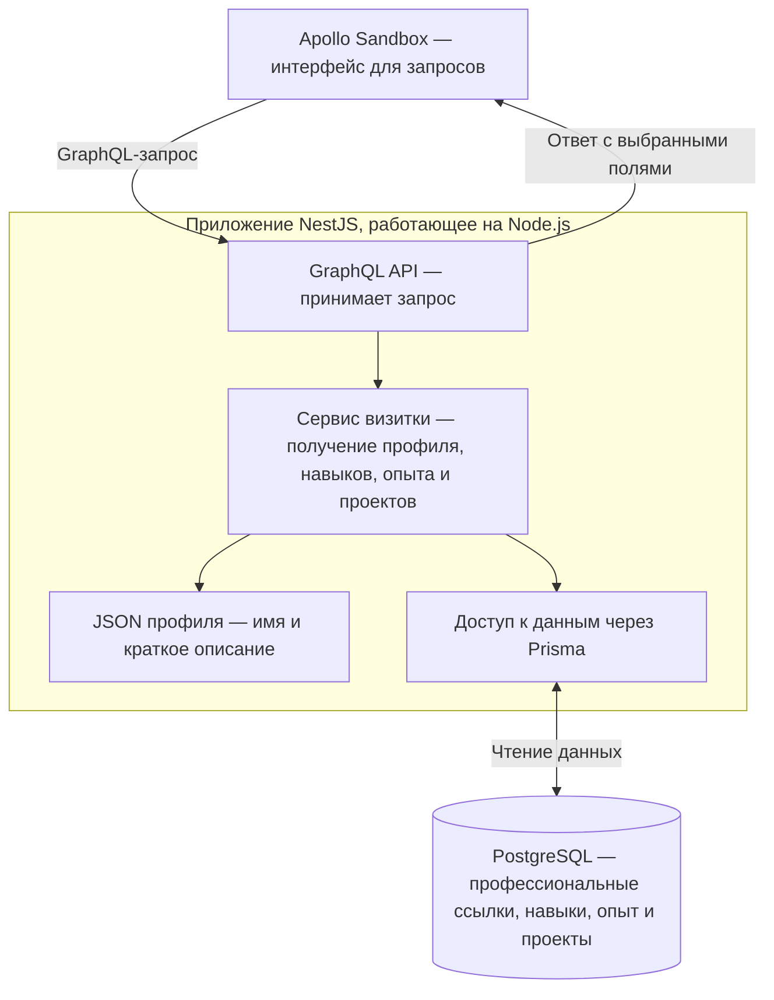

# Цифровая визитка

Apollo sandbox приложения развёрнут и доступен по адресу [backend-production-e88a.up.railway.app/graphql ](https://backend-production-e88a.up.railway.app/graphql)

## Архитектура приложения



## Запуск

Выполните команду из корня проекта, где находится `compose.yaml`:

```sh
docker compose up --build --wait
```

При первом запуске миграции создают таблицы PostgreSQL и заполняют их данными визитки. Команда завершится, когда бэкенд запустится и подтвердит подключение к базе.

- **/graphql** Apollo Sandbox для запросов к визитке.
- **/health** Проверка готовности для проверки подключения к базе.

## Тесты бэкенда

Из каталога `backend` после `npm ci` выполните `npm run test:unit` для модульных проверок готовности бэкенда. Команда `npm run test:integration:isolated` проверяет миграции и работу GraphQL. Для неё нужен запущенный Docker. Тесты создают временную PostgreSQL и отдельный экземпляр бэкенда, а затем удаляют окружение.

Команда `npm run test:integration` проверяет уже запущенный API. По умолчанию используется `http://127.0.0.1:3000`. Другой адрес можно задать через `TEST_BASE_URL`.

Для проверки в браузере откройте Sandbox и выполните `{ skills { name } }`.
